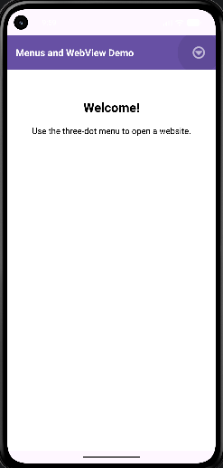
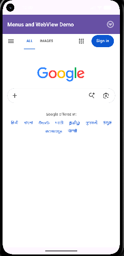
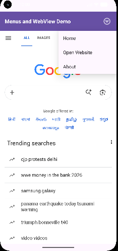

# Menu and WebView Android Application

 

## Overview

A simple Android application built with Kotlin and XML that demonstrates an Options Menu and WebView.

 

## Aim

To implement menu options and display a website inside an Android application using WebView.

 

## Features

- **Home:** Displays a welcome message in the WebView.

- **Open Website:** Loads Google inside the app.

- **About:** Displays a Toast message.

- **Options Menu:** Provides navigation through the three menu items.

 

## Technologies Used

- Android Studio

- Kotlin

- XML

- Android WebView

- Git and GitHub

 

## Screenshots

 

### Output 1



 

### Output 2



 

### Output 3



 

## How to Run

1. Clone or download this repository.

2. Open the project in Android Studio.

3. Wait for Gradle sync to finish.

4. Run the app on an emulator or Android device.

5. Tap the menu button and select **Home**, **Open Website**, or **About**.

 

## Internet Permission

The application requires this permission in `AndroidManifest.xml` to load online websites:

 

```xml

<uses-permission android:name="android.permission.INTERNET" />

```

 

## Repository

https://github.com/Lathika-kathirvel/Menu-webView-app

 

## Conclusion

This project demonstrates menu handling and displaying web content inside an Android application using WebView.
